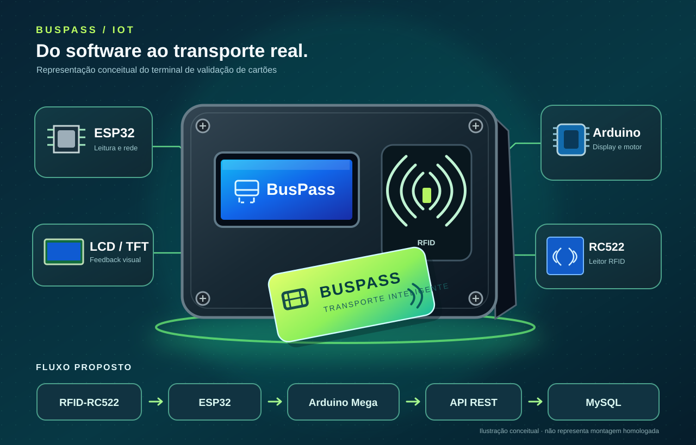

# 🚌 BusPass — Mobilidade urbana mais simples e conectada

<p align="center">
  <strong>Uma aplicação web para gerenciar cartões, consultar saldos, realizar recargas demonstrativas e acessar informações do transporte público.</strong>
</p>

<p align="center">
  <a href="https://landing-page-wt6o.onrender.com">🌐 Landing page</a> ·
  <a href="https://frontend-projeto-kmjv.onrender.com">🚌 Acessar aplicação</a> ·
  <a href="https://github.com/vtvitor/frontend-projeto">Front-end</a> ·
  <a href="https://github.com/vtvitor/backend-projeto">Back-end</a>
</p>

> **Status:** projeto acadêmico/demonstrativo em desenvolvimento. O foco principal é a **plataforma digital**. As recargas alteram créditos registrados no sistema; **não há processamento de pagamentos bancários reais**.

## 📚 Contexto e problema

O transporte público faz parte da rotina de milhares de pessoas, mas consultar o saldo do cartão, encontrar pontos de ônibus e obter informações sobre linhas nem sempre é simples. Quando essas informações ficam dispersas, o passageiro precisa recorrer a diferentes canais para planejar seu deslocamento.

O **BusPass**, desenvolvido pela equipe **Four Sync**, propõe centralizar o gerenciamento de cartões e informações sobre mobilidade urbana em uma interface web prática, acessível e organizada.

O projeto combina **front-end, back-end e banco de dados**, com um protótipo físico complementar que explora a identificação de cartões por RFID.

## 🎯 Objetivos

- **Centralizar cartões e saldos:** oferecer uma forma simples de consultar e administrar cartões de transporte.
- **Simplificar recargas demonstrativas:** atualizar e visualizar créditos na plataforma.
- **Facilitar a consulta ao transporte:** disponibilizar informações sobre linhas e pontos de ônibus.
- **Apoiar o planejamento de trajetos:** utilizar mapas e dados cadastrados para visualizar deslocamentos.
- **Priorizar a experiência do passageiro:** desenvolver uma interface intuitiva e adaptável a diferentes telas.
- **Explorar integrações tecnológicas:** conectar o aplicativo a uma API REST, banco de dados e, como extensão, um terminal RFID.

## 💻 Funcionalidades do aplicativo

| Funcionalidade | Descrição |
| --- | --- |
| **Cadastro e login** | Criação de contas e autenticação básica pela API. |
| **Gerenciamento de cartões** | Cadastro, listagem e exclusão de cartões vinculados a um usuário. |
| **Consulta de saldo** | Exibição do saldo em créditos, armazenado em centavos no banco. |
| **Recargas** | Adição de créditos demonstrativos, sem integração com Pix ou pagamento bancário. |
| **Linhas e pontos de ônibus** | Consulta de informações disponibilizadas pelos dados e endpoints do projeto. |
| **Mapa interativo e trajetos** | Visualização de pontos e exploração de trajetos com recursos de mapa. |
| **Interface web** | Navegação entre os recursos do BusPass em HTML, CSS e JavaScript. |

**Observação:** a presença das funcionalidades no código não equivale a homologação ou operação em produção. O projeto ainda precisa de reforços de segurança e testes integrados. Os dados do mapa não devem ser interpretados como localização de ônibus em tempo real.

## 🛠️ Tecnologias e arquitetura

| Camada | Tecnologias |
| --- | --- |
| **Front-end** | HTML5, CSS3 e JavaScript |
| **Back-end** | Java 21 e Spring Boot 3.5.6 |
| **Comunicação** | API REST, HTTP e JSON |
| **Banco de dados** | MySQL |
| **Persistência** | Spring Data JPA / Hibernate |
| **Build e implantação** | Maven, Docker e Render |
| **Extensão física** | ESP32, Arduino Mega, RFID-RC522, display TFT e peças 3D |

A aplicação digital está organizada em camadas: **interface → API REST → regras de negócio → persistência no MySQL**. Essa separação facilita a evolução de funcionalidades e a manutenção do código.

## 🔗 Links e repositórios

Além do repositório integrado do BusPass, os módulos digitais também podem ser consultados separadamente, como no projeto original:

| Recurso | Link |
| --- | --- |
| **Projeto completo (BusPass)** | [github.com/vtvitor/BusPass](https://github.com/vtvitor/BusPass) |
| **Front-end (repositório separado)** | [github.com/vtvitor/frontend-projeto](https://github.com/vtvitor/frontend-projeto) |
| **Back-end (repositório separado)** | [github.com/vtvitor/backend-projeto](https://github.com/vtvitor/backend-projeto) |
| **Landing page (repositório separado)** | [github.com/vtvitor/-landing-page](https://github.com/vtvitor/-landing-page) |
| **Landing page publicada** | [landing-page-wt6o.onrender.com](https://landing-page-wt6o.onrender.com) |
| **Aplicação web publicada** | [frontend-projeto-kmjv.onrender.com](https://frontend-projeto-kmjv.onrender.com) |

> O **BusPass** é o repositório integrado; os links de front-end, back-end e landing page acima apontam para repositórios separados. Eles podem evoluir independentemente, portanto confira a versão do código de cada um.

## 📦 Estrutura do projeto

```text
BusPass/
├── Front-end/              # Interface do aplicativo, mapa e cartões
├── Back-end/               # API REST, controllers, services e JPA
├── Banco-De-Dados/         # Script SQL e dados iniciais
├── Landing-page/           # Página de apresentação
├── Codigo-IoT/             # Código do ESP32 e do Arduino Mega
├── Modelagem-fisica/       # Arquivos STL do protótipo
├── assets/                 # Ilustração conceitual do terminal
└── README.md
```

O **front-end e o back-end** formam o núcleo digital do projeto. As pastas de eletrônica e modelagem representam a extensão experimental do sistema.

## 🚀 Como executar localmente

**Pré-requisitos:** JDK 21, Maven, MySQL e navegador moderno.

1. Clone o projeto:
   ```bash
   git clone https://github.com/vtvitor/BusPass.git
   cd BusPass
   ```
2. Configure o MySQL e consulte `Banco-De-Dados/Creates.sql`. Verifique a compatibilidade do esquema SQL com as entidades JPA antes de importar dados.
3. Configure as variáveis de ambiente de conexão com o banco utilizadas por `Back-end/src/main/resources/application.properties`. Não publique credenciais reais.
4. Na pasta `Back-end`, inicie a API:
   ```bash
   cd Back-end
   mvn spring-boot:run
   ```
5. Ajuste a URL da API em `Front-end/api.js` e abra a pasta `Front-end/` em um servidor HTTP local, como o Live Server do VS Code.
6. Teste o cadastro, login, gerenciamento de cartões e consultas ao mapa usando **dados fictícios**.

### Endpoints principais

| Método | Endpoint | Finalidade |
| --- | --- | --- |
| `POST` | `/api/auth/register` | Cadastrar usuário |
| `POST` | `/api/auth/login` | Login básico |
| `GET` | `/api/cartoes?usuarioId=...` | Listar cartões |
| `POST` | `/api/cartoes` | Cadastrar cartão |
| `POST` | `/api/cartoes/{id}/recarga` | Adicionar créditos demonstrativos |
| `POST` | `/api/cartoes/pagar` | Debitar saldo por número do cartão |
| `GET` | `/api/linhas` | Consultar linhas |
| `GET` | `/api/pontos` | Consultar pontos |

## 🔌 Extensão do projeto: protótipo físico

Como demonstração complementar, o BusPass inclui uma proposta de **terminal de leitura RFID** para simular a validação de cartões de transporte. O código existente contempla leitura com **ESP32 + RC522**, comunicação com a API e comandos destinados ao **Arduino Mega**, ao **display TFT** e ao motor da catraca.

<p align="center">
  
</p>

<p align="center"><sub>Representação conceitual, não fotografia de uma montagem final validada.</sub></p>

**Fluxo proposto:** cartão RFID → leitor RC522 → ESP32 → API Java/Spring Boot → MySQL → resposta ao ESP32 → Arduino Mega (display e motor).

O protótipo físico **não é necessário para utilizar a aplicação web**. Os testes de integração de hardware, encaixes da case e operação completa da catraca precisam ser validados antes de apresentar o conjunto como finalizado.

## 🔐 Limitações e melhorias necessárias

O projeto tem finalidade educacional e **não deve ser utilizado com dados pessoais ou cobranças reais sem revisão de segurança**. As principais prioridades são:

- Aplicar hash seguro nas senhas e autenticação/autorização efetivas nos endpoints.
- Restringir consultas, recargas e exclusões aos usuários e dispositivos autorizados.
- Remover e trocar credenciais eventualmente publicadas e validar certificados HTTPS na comunicação com o ESP32.
- Tratar débitos e recargas com transações seguras, validações e testes automatizados.
- Diferenciar claramente dados de demonstração de dados atualizados de transporte público.

### Próximas evoluções

- Melhorar a experiência de cadastro, acompanhamento de saldo e administração de cartões.
- Ampliar os testes da aplicação, da API e do banco de dados.
- Explorar integração com pagamentos reais por meio de um provedor confiável.
- Estudar notificações de saldo baixo e informações de transporte mais atualizadas.
- Concluir os testes do terminal RFID e da montagem física como módulo complementar.

## 👥 Equipe — Four Sync

| Integrante | Responsabilidade |
| --- | --- |
| [Vitor Derencio](https://github.com/vtvitor) | Desenvolvimento full-stack |
| [Leticia S. Meira](https://github.com/leticiameira-star) | Desenvolvimento full-stack |
| [Maria C. Feitosa](https://github.com/konomi-naruko) | Desenvolvimento front-end |
| [Kauan Fernandes S.](https://github.com/kauan-cmd-alt) | UI/UX Design |

---

<p align="center"><strong>BusPass</strong> — Tecnologia para uma mobilidade urbana mais prática.<br />Desenvolvido pela equipe <strong>Four Sync</strong>.</p>
