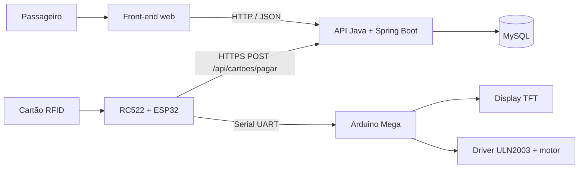

# Arquitetura do BusPass

## Visão geral

O desenho representa a **arquitetura pretendida**, não certifica que o protótipo completo já foi validado. A API possui endpoints de cadastro, cartões, recarga, débito, linhas e pontos.

### Principais fluxos

- **Web:** navegador envia JSON para a API, que consulta/persiste dados no MySQL.
- **Leitura física:** RC522 fornece o UID ao ESP32; o firmware tenta debitar a passagem pela API.
- **Resposta:** ESP32 envia mensagens pela UART ao Mega; este atualiza o TFT e, em caso de aprovação, comanda o motor através de driver.

### Considerações de confiabilidade

A autorização não deve se basear apenas no UID RFID: ele pode ser copiado em algumas tecnologias. O endpoint de débito precisa de autenticação de dispositivo, proteção contra repetição e transação atômica. A implementação atual deve ser tratada como **demonstração**, não bilhetagem real.
